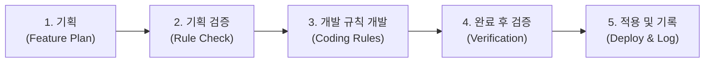

# 🛡️ '프로의 길 : 인연' 표준 개발 & 시나리오 검증 규정집
## (Development & Scenario Verification Standard Pipeline v1.0)

---

## 📌 1. 5단계 표준 개발 파이프라인 (5-Stage Pipeline)

모든 신규 기능 추가, 스토리 확장, 밸런스 패치, 버그 수정은 반드시 아래 **5단계 프로세스**를 엄격히 준수하여 순차적으로 진행합니다.

---

### [1단계] 기능 및 시나리오 기획 (Feature Plan)
* 개발하려는 신규 시스템, 대사, 이벤트의 목적과 세부 스펙 정의.
* 대상 히로인, 등장 스테이지(Stage 0~6), 소모 자원(턴, 돈, 체력, 스트레스) 명시.

### [2단계] 규칙에 맞는 기획 검증 (Spec Review against Rules)
* **서사 일관성 검증**: [SCENARIO_BIBLE.md](file:///d:/antigravity/pro-gamer/SCENARIO_BIBLE.md)의 캐릭터 성격 및 스테이지 분위기와 일치하는가?
* **밸런스 검증**: 기대 보상과 리스크가 기존 수치 공식(OVR 가중치, 임대수익률, 연봉 곡선)을 왜곡하지 않는가?
* **역할 중복 검증**: 기존 10인 히로인의 고유 버프/잭팟과 충돌하거나 하위 호환이 되지 않는가?

### [3단계] 개발 규칙에 따른 개발 (Coding Standards)
* **하위 호환성 원칙**: 기존 저장 데이터(`localStorage`)가 깨지지 않도록 모든 신규 필드에 null-safe 기본값(`P.field || default`)을 부여.
* **클린 코드 & 가독성**: 함수 분리, 모듈화, 비동기(`async/await`) 처리 시 UI 프리징 방지.
* **자원 무결성**: 추가되는 모든 이미지, 오디오, 텍스트 리소스가 유효한 상대 경로를 갖도록 처리.

### [4단계] 개발완료 후 검증규칙에 맞는 검증 (Automated Testing)
* **레벨 1 (문법 검증)**: Node.js AST 구문 분석을 통한 JavaScript 0-SyntaxError 보장.
* **레벨 2 (데이터 무결성 검증)**: 10인 히로인 데이터, 15종 챔피언 데이터, 스탯 매핑 전수 조사.
* **레벨 3 (시나리오 체커)**: 시나리오 바이블과의 일치성(아이콘, 이름, 스토리 분기 등) 자동 검증.
* **레벨 4 (런타임 시뮬레이션)**: 브라우저 환경에서 1~10턴 자동 진행 및 모달 팝업 무결성 확인.
* **레벨 5 (빌드 검증)**: 안드로이드 APK 및 PWA 매니페스트 컴파일 정상 확인.

### [5단계] 적용 및 시나리오 체크리스트 기록 (Deploy & Log)
* `index.html` 프로덕션 적용 및 [SCENARIO_CHECKLIST.md](file:///d:/antigravity/pro-gamer/SCENARIO_CHECKLIST.md)에 작업 내역, 검증 결과, 버전 넘버 영구 기록.
* 안드로이드 APK 및 배포 압축팩 최신화.
