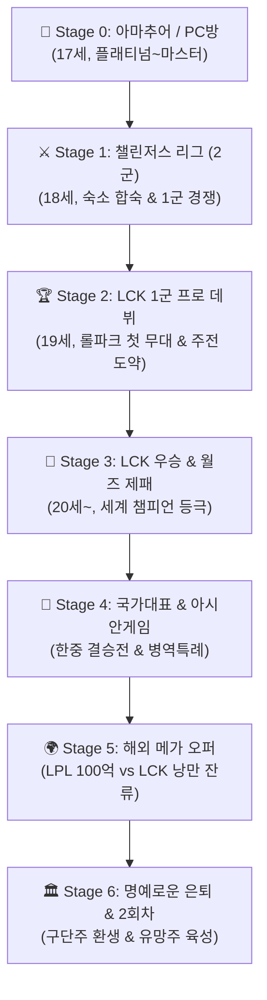
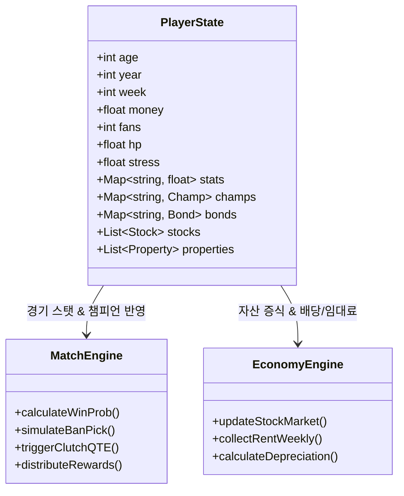

# 🎮 프로의 길 : 인연 (Pro Gamer: Bonds)
## 📖 종합 시나리오 바이블 & 시스템 밸런스 설계서 (Scenario & Game Bible v1.2)

---

## 📌 1. 프로젝트 개요 & 세계관 핵심

### 1.1 로그라인 (Logline)
> **"낡은 동네 PC방 27번 좌석에서 시작된 17세 플래티넘 소년의 꿈. 10인의 매력적인 인연들과 함께 피지컬과 멘탈을 갈고닦아 LCK, 월즈, 아시안게임 금메달을 거머쥐고, 마침내 e스포츠 전설이자 구단주로 거듭나는 성장 로맨스 시뮬레이션."**

### 1.2 핵심 기획 의도 & 방향성 원칙
1. **서사의 일관성과 연계성 (Coherence & Continuity)**:
   - 모든 이벤트와 인연 대화는 주인공의 커리어 단계(아마추어 ➔ 2군 ➔ 1군 주전 ➔ 월드스타 ➔ 은퇴/구단주)에 유기적으로 연동되어 대사와 심경, 주변 시선이 현실적으로 변화합니다.
2. **선택과 기회비용의 밸런스 (Balance & Risk-Reward)**:
   - 훈련(능력치) / 솔랭(티어) / 휴식(스트레스 케어) / 데이트(인연 버프 및 잭팟) 간의 턴 자원 분배 밸런스를 정교하게 설계하여 원패턴 플레이를 방지합니다.
3. **낭만과 현실의 조화**:
   - 승부의 냉혹함(연패 시 슬럼프, 팬들의 악플, 계약 해지 위기)과 따뜻한 인연의 구원(히로인들의 멘탈 케어, 홈쿡 아침밥, 든든한 지원)을 대조시켜 몰입감을 극대화합니다.

---

## 🗺️ 2. 커리어 단계별 메인 시나리오 아크 (Main Story Progression)

---

### [Stage 0] 동네 PC방의 방구석 천재 (17세)
* **주요 배경**: 번화가 골목의 낡은 동네 PC방, 컵라면과 밤샘 솔랭.
* **갈등 요소**: 
  - 부모님의 진로 반대 ("게임으로 밥 벌어먹고 살겠냐?").
  - 낡은 마우스와 렉 걸리는 모니터로 인한 서러움.
  - 마의 다이아몬드 승급전에서 트롤을 만나 겪는 멘탈 붕괴.
* **주요 사건**:
  - 소꿉친구 **이지은**이 몰래 챙겨주는 수제 도시락과 격려.
  - 상금 50만원이 걸린 **동네 PC방 토너먼트 대회** 출전 ➔ 1:5 클러치 슈퍼플레이로 우승.
  - 관중석에서 경기를 지켜보던 프로팀 스카우터의 명함 수령: *"너, 우리 2군 테스트 한번 볼래?"*
* **돌파 조건**: 솔랭 다이아몬드 달성 OR PC방 토너먼트 1회 우승.

---

### [Stage 1] 챌린저스 리그 (CL) 2군 유망주 (18세)
* **주요 배경**: 일산/강남 외곽의 프로팀 2군 합숙 숙소, 2층 침대와 빡빡한 스크림 일정.
* **갈등 요소**:
  - 아마추어 시절의 개인기(피지컬)만으로는 통하지 않는 **팀 호흡(시너지)**의 벽.
  - 동갑내기 연습생들과의 살벌한 주전 경쟁 및 방출 위기.
  - 월 150만원(연봉 1,800~2,400만원)의 빠듯한 살림.
* **주요 사건**:
  - 레전드 1군 선배 **강미나**와의 심야 1:1 라인전 과외 및 멘탈 조언 ("프로는 잘하는 놈이 아니라, 끝까지 버티는 놈이 이긴다").
  - 챌린저스 결승전에서 불리했던 경기를 기적의 바론 오더로 뒤집으며 MVP 수상.
  - 1군 주전 선수의 손목 부상으로 인한 **긴급 1군 콜업 통보**.
* **돌파 조건**: 오버롤 65 이상, 팀 호흡 3 이상, CL 포스트시즌 우승.

---

### [Stage 2] LCK 1군 프로 데뷔 (19세)
* **주요 배경**: 종각 롤파크(LoL PARK), 화려한 조명과 함성, 백스테이지 방송 부스.
* **갈등 요소**:
  - 첫 방송 경기에서의 극심한 긴장감과 손떨림 (우황청심환 복용).
  - 커뮤니티(디시, 인벤)의 가차 없는 악플과 평점 테러.
  - 베테랑 상대팀의 집중 밴카드와 3인 다이브 설계.
* **주요 사건**:
  - 데뷔전 단독 POG(Player of the Game) 선정 후 LCK 글로벌 인터뷰어 **클로이**와의 첫 인터뷰.
  - 격렬한 손목 통증으로 방문한 e스포츠 전담 클리닉에서 주치의 **백설아**와의 운명적 만남.
  - 현역 톱 아이돌 **하린**이 관중석에서 내 유니폼을 들고 직관하는 장면이 중계 카메라에 잡히며 전국적 화제.
* **돌파 조건**: 오버롤 75 이상, LCK 1군 승격 및 플레이오프 진출.

---

### [Stage 3] LCK 정상 & 월드 챔피언십 (월즈) 제패 (20세~)
* **주요 배경**: 서울 올림픽체조경기장(LCK 결승) ➔ 해외 돔구장(월즈 결승).
* **갈등 요소**:
  - 세계 최강팀(T1, GEN, LPL 전통 강호)과의 5판 3선승제 피말리는 두뇌 싸움.
  - 메타 변화에 따른 주력 챔피언 너프 및 밴픽 위기.
* **주요 사건**:
  - 대기업 한성그룹 후원사 따님 **윤소라**의 통 큰 네이밍 스폰서 계약 및 전폭적 지원.
  - 경기 전날 클래식 공연장에서 만난 천재 첼리스트 **장세아**의 선율을 통해 얻은 궁극의 평정심.
  - 월즈 결승 5세트, 40분 바론 앞 5인 한타에서 역사에 남을 **'점멸 5인궁 클러치'** 성공 ➔ 전 세계 1억 명이 지켜보는 가운데 소환사의 컵(Summoner's Cup) 리프팅!
* **돌파 조건**: LCK 우승, 월즈 토너먼트 우승 (스킨 헌정 자격 획득).

---

### [Stage 4] 대한민국 국가대표 & 아시안게임 금메달
* **주요 배경**: 아시안게임 주경기장, 태극마크가 새겨진 국가대표 단복.
* **갈등 요소**:
  - 국가적 기대감에 따른 엄청난 중압감.
  - 라이벌 중국 국가대표팀의 무자비한 맞춤 전략.
* **주요 사건**:
  - 국가대표 선발전 전승 통과 ➔ 결승전 한중전 3:2 풀세트 접전 끝에 금메달 획득.
  - **체육요원 병역특례(군 면제)** 혜택 및 대통령 체육훈장 수훈.
  - 대한민국 국민 스포츠 스타로 공중파 뉴스 메인 장식.
* **돌파 조건**: 국가대표 선발전 승리 & 결승 중국전 제압.

---

### [Stage 5] 글로벌 슈퍼스타 & 거대 자본의 유혹
* **주요 배경**: 강남 테헤란로 에이전시 본사 회의실, LPL 상하이 본부.
* **갈등 요소**:
  - LPL/LCS 구단들의 백지수표 (연봉 100억~120억 원 제안).
  - LCK 잔류와 국내 팬들에 대한 의리 사이에서의 고뇌.
* **주요 사건**:
  - 에이전시 대표 **서예진**의 치밀한 법률 검토와 최고 대우 보장 계약 조율.
  - 글로벌 올스타전에서 만난 일본 LJL 여고수 **미야모토 린**과의 친선전 & 코스프레 콜라보.
  - 브라질 피트니스 코치 **카밀라 노바**의 피지컬 벌크업으로 프로게이머 고질병 완치.
* **돌파 조건**: 연봉 재계약 50억~100억 달성, 슈퍼카 및 부동산 자산 형성.

---

### [Stage 6] 명예로운 은퇴 & 뉴게임+ (구단주 환생 모드)
* **주요 배경**: 롤파크 영구결번 헌정식, 내가 인수한 신생 프로 구단 사옥.
* **내러티브 마무리**:
  - 모든 트로피(국내, 국제, 국대)를 들어올린 후 박수칠 때 떠나는 아름다운 은퇴.
  - 사랑하는 히로인과의 성대한 결혼식 & 강남 펜트하우스 신혼 생활.
  - **2회차 (New Game+)**: 축적된 수백억 자본금을 바탕으로 직접 프로 구단주가 되어, 동네 PC방에서 과거의 자신 같은 유망주를 발굴·육성하는 매니지먼트 모드 오픈.

---

## 💖 3. 10인 히로인 상세 캐릭터 바이블 (Heroine Bible)

모든 히로인은 고유한 **등장 조건(Unlock)**, **호감도 4단계 스토리**, **갈등/해소 이벤트**, **동거/결혼 후일담**, 그리고 **대박 잭팟(Windfall)**을 지닙니다.

---

### 1. 이지은 (Lee Ji-eun) — 18세, 소꿉친구 & 헌신적인 1호 팬
* **키/체형/외모**: 160cm, 아담하고 귀여운 체형, 갈색 포니테일, 맑고 순수한 눈망울, 교복/캐주얼 후드티.
* **성격**: 다정다감, 헌신적, 주인공을 누구보다 신뢰하며 묵묵히 곁을 지키는 비타민 같은 존재.
* **등장 조건**: 프롤로그 시작과 함께 기본 해금.
* **인연 버프**: 휴식 시 체력 회복량 +40%, 스트레스 감소치 +50%, 번아웃 완전 면역.
* **호감도 서사 아크**:
  - `Lv.1 호감 (0~30)`: PC방 밤샘 때마다 몰래 편의점에서 사다 주는 삼각김밥과 바나나우유.
  - `Lv.2 썸 (31~70)`: 프로 2군 합숙소 입소 전날, 한강 둔치에서 나눈 따뜻한 캔커피와 첫 손잡기.
  - `Lv.3 연인 (71~99)`: LCK 결승전 관중석 맨 앞줄에서 눈물을 흘리며 외치는 "너는 내 평생의 챔피언이야!"
  - `Lv.4 영원한 약속 (100)`: 낡은 반지 대신 월즈 우승 메달을 목에 걸어주며 프로포즈.
* **동거/결혼 아침 식사 버프**: 따뜻한 소고기 미역국과 계란말이 (`체력 +20`, `멘탈 완전 회복`).
* **대박 잭팟 (Windfall)**: 이지은이 주인공 모르게 시작했던 '프로게이머 남친 성장기 숏폼 채널'이 100만 구독자를 돌파하며 유튜브 수익 5,000만원 일시 지급 & 스트레스 -50.

---

### 2. 하린 (Harin) — 19세, 현역 톱 K-POP 아이돌 (인기 걸그룹 센터)
* **키/체형/외모**: 166cm, 황금비율 슬렌더 체형, 찰랑거리는 흑발 긴 생머리, 화려하고 인형 같은 이목구비.
* **성격**: 무대 위에선 완벽한 퀸, 주인공 앞에선 솔직하고 애교 많은 숨은 롤 중독자 (주 챔피언: 징크스).
* **등장 조건**: LCK 1군 데뷔전 승리 후 관중석 직관 이벤트로 해금.
* **인연 버프**: 팬덤 증가 속도 2배, SNS 스폰서 제휴 수입 +40%.
* **호감도 서사 아크**:
  - `Lv.1`: 음악방송 대기실에서 주인공 솔랭 다시보기를 보다 매니저에게 걸리는 해프닝.
  - `Lv.2`: 선글라스와 마스크를 쓰고 심야 한강 드라이브 떡볶이 비밀 데이트.
  - `Lv.3`: 디스패치 열애설 파파라치 위기! 그러나 하린이 SNS 라이브로 당당하게 "제가 먼저 짝사랑한 선수예요" 선언.
  - `Lv.4`: 콘서트 앵콜 무대에서 5만 관객 앞에 주인공을 소개하며 공개 헌정곡 열창.
* **동거/결혼 아침 식사 버프**: 아이돌 식단 뷰티 아보카도 샐러드 & 단백질 스무디 (`팬덤 매력도 +20`, `스마트폰 악플 스트레스 면역`).
* **대박 잭팟**: 하린의 신곡 뮤직비디오에 주인공이 단독 주연으로 우정 출연하여 글로벌 음원 1위 달성 ➔ 특별 모델료 1억 5천만원 입금.

---

### 3. 윤소라 (Yoon So-ra) — 23세, 한성그룹 재벌 3세 & e스포츠 구단주 딸
* **키/체형/외모**: 168cm, 세련되고 우아한 글래머러스 체형, 우아한 골드 브라운 롱웨이브, 명품 하이패션 수트.
* **성격**: 도도하고 냉철한 츤데레 사업가, 하지만 내 남자에게는 아낌없이 퍼주는 영앤리치.
* **등장 조건**: 누적 상금 1억원 달성 OR LCK 상위권 진출 시 해금.
* **인연 버프**: 매주 금융 자산 투자 배당금 +30%, 상점 내 최고급 장비 30% 할인.
* **호감도 서사 아크**:
  - `Lv.1`: "너 얼마면 돼? 우리 팀으로 올래?" 파격적인 연봉 제시로 첫 대면.
  - `Lv.2`: 5성급 호텔 최고층 펜트하우스에서 진행되는 비즈니스를 가장한 단둘만의 프라이빗 디너.
  - `Lv.3`: 재벌가 정략결혼 압박을 거부하고 "내 남자는 내가 직접 키운 월드 챔피언이야" 선언.
  - `Lv.4`: 전용 헬기를 타고 떠난 지중해 프라이빗 섬에서 나눈 백년가약.
* **동거/결혼 아침 식사 버프**: 최고급 호텔 셰프 케이터링 트러플 스테이크 브런치 (`전 스탯 +3`, `자산 투자 성공률 +15%`).
* **대박 잭팟**: 윤소라가 선물한 한성그룹 미공개 바이오/엔터 신주 상장으로 하룻밤 사이에 주식 대박 ➔ 현금 3억원 즉시 입금.

---

### 4. 강미나 (Kang Mi-na) — 22세, 전설의 1세대 프로게이머 선배 (현 명품 해설위원)
* **키/체형/외모**: 165cm, 날렵하고 활동적인 슬렌더 체형, 시크한 숏컷 헤어, 후드집업과 트레이닝 팬츠의 걸크러시.
* **성격**: 털털하고 호탕한 누나, 게임에 있어서는 누구보다 엄격한 멘토이자 든든한 술친구.
* **등장 조건**: 챌린저스 리그 합숙소 입소 시 해금.
* **인연 버프**: 스크림 경기력 보정 +15%, 밴픽 상성 분석력 대폭 상승.
* **호감도 서사 아크**:
  - `Lv.1`: "야, 방금 무빙 꼬라지가 그게 뭐냐? 나와, 1:1 맞짱 까자."
  - `Lv.2`: 포장마차에서 나누는 닭발과 소주 한 잔, 은퇴 후의 쓸쓸함과 열정을 털어놓으며 가까워짐.
  - `Lv.3`: 결승전 해설석에서 주인공의 역전 한타를 보며 오열 섞인 샤우팅: "제가 말했잖아요! 이 선수는 역사를 쓸 거라고!"
  - `Lv.4`: 은퇴식 날 롤파크 옥상에서 나누는 진한 키스와 영원한 동반자 선언.
* **동거/결혼 아침 식사 버프**: 얼큰한 황태 해장국과 스팸구이 (`경기 집중력 +15%`, `한타 클러치 확률 +10%`).
* **대박 잭팟**: 강미나와 함께 나간 레전드 올스타 이벤트 매치 전승 우승 ➔ 특별 스폰서 상금 8,000만원 획득.

---

### 5. 장세아 (Jang Se-ah) — 20세, 세계적인 천재 클래식 첼리스트
* **키/체형/외모**: 163cm, 가녀리고 단아한 청순 체형, 반묶음 긴 생흑발, 백옥 같은 피부와 서정적인 눈빛, 클래식 드레스.
* **성격**: 조용하고 사색적, 완벽주의로 인한 예술적 슬럼프 속에서 게임의 치열함과 카타르시스에 매료됨.
* **등장 조건**: 스트레스 80 이상 도달 시 예술의 전당 힐링 이벤트로 해금.
* **인연 버프**: 경기 패배 시 멘탈 붕괴 완전 방지, 피지컬 훈련 성장치 +25%.
* **호감도 서사 아크**:
  - `Lv.1`: 첼로 케이스를 메고 한밤중 PC방 구석에서 롤을 하던 중 주인공에게 정글 갱킹 훈수를 두며 첫 만남.
  - `Lv.2`: 텅 빈 콘서트홀에서 오직 주인공 한 사람만을 위해 켜는 바흐 무반주 첼로 모음곡.
  - `Lv.3`: 세계 콩쿠르 우승 트로피를 안고 공항에 내리자마자 주인공의 롤파크 경기장으로 직행.
  - `Lv.4`: 클래식과 e스포츠가 어우러진 롤드컵 결승 오프닝 세레머니에서 합동 무대 후 청혼.
* **동거/결혼 아침 식사 버프**: 유기농 허브티와 프랑스풍 크루아상 (`최대 스트레스 한도 120으로 확장`, `슬럼프 면역`).
* **대박 잭팟**: 장세아가 주인공의 명경기 플레이를 테마로 작곡한 교향시 앨범이 빌보드 클래식 차트 1위 기록 ➔ 로열티 정산 1억원 입금.

---

### 6. 클로이 발렌타인 (Chloe Valentine) — 24세, LCK 글로벌 중계 인터뷰어
* **키/체형/외모**: 170cm, 서구적인 S라인 글래머, 눈부신 백금발 비치웨이브, 에메랄드빛 눈동자, 세련된 원피스.
* **성격**: 지적이고 프로페셔널하며 재치 넘침, 백스테이지에선 허당기 있고 한국 문화를 사랑함.
* **등장 조건**: LCK 정규 시즌 단독 POG 인터뷰 1회 달성 시 해금.
* **인연 버프**: 해외 구단 이적료 가치 +35%, 인터뷰 방송 노출 시 팬덤 폭증.
* **호감도 서사 아크**:
  - `Lv.1`: 생방송 인터뷰 중 주인공의 센스 있는 농담에 빵 터져 NG를 낼 뻔한 백스테이지 첫 교감.
  - `Lv.2`: 익선동 한옥마을에서 한복을 입고 길거리 음식을 먹는 로맨틱한 서울 투어.
  - `Lv.3`: 해외 원정 경기 호텔 로비에서 파파라치를 피해 주인공 방으로 숨어들어온 심쿵 하룻밤.
  - `Lv.4`: 라이엇 게임즈 공식 글로벌 시상식에서 올해의 커플상 수상 및 전 세계 생중계 프로포즈.
* **동거/결혼 아침 식사 버프**: 정통 아메리칸 팬케이크 & 메이플 시럽과 갓 내린 드립커피 (`영어 인터뷰 버프`, `해외 팬덤 +50%`).
* **대박 잭팟**: 클로이가 주선한 글로벌 명품 게이밍 브랜드(레이저, 로지텍 글로벌) 글로벌 앰버서더 체결 ➔ 계약금 2억원 일시불 입금.

---

### 7. 백설아 (Baek Seol-ah) — 26세, 팀 전담 주치의 & 스포츠 정형외과 전문의
* **키/체형/외모**: 167cm, 단아하고 지적인 누님 체형, 깔끔한 로우번 헤어, 무테안경, 흰 의사 가운 속 슬림핏 셔츠.
* **성격**: 겉으로는 차갑고 냉철한 팩폭 의사, 속으로는 선수의 건강과 미래를 그 누구보다 걱정하는 헌신파.
* **등장 조건**: 부상 위험도 40 이상 또는 누적 경기 15회 이상 시 클리닉 이벤트로 해금.
* **인연 버프**: 손목/목 디스크 등 모든 프로게이머 부상 발생 확률 0%, 경기 피로도 누적 -50%.
* **호감도 서사 아크**:
  - `Lv.1`: "자기 몸을 이렇게 혹사시키면서 게임하는 게 자랑인가요? 손목 내밀어요." 날카로운 첫 진료.
  - `Lv.2`: 진료실 문을 닫고 단둘이 진행하는 프라이빗 손목 도수치료와 야간 드라이브.
  - `Lv.3`: 경기 도중 극심한 경련이 온 주인공의 손을 주치의 권한으로 응급처치하며 눈물로 완주를 도움.
  - `Lv.4`: "이제 당신 몸은 의사가 아니라, 아내로서 평생 내가 관리할게요."
* **동거/결혼 아침 식사 버프**: 한방 보약 삼계탕과 비타민 영양제 세트 (`체력 상시 100 유지`, `부상 원천 차단`).
* **대박 잭팟**: 백설아가 개발한 'e스포츠 맞춤형 특허 손목 보호대'가 전 세계 게이머들에게 불티나게 팔려 ➔ 지분 배당금 1억 2천만원 지급.

---

### 8. 미야모토 린 (Miyamoto Rin) — 21세, 일본 LJL 최강 여고수 & 프로 코스플레이어
* **키/체형/외모**: 154cm, 아담하고 귀여운 쁘띠 갸루 체형, 핑크/라벤더 투톤 양갈래 트윈테일, 서브컬처 패션.
* **성격**: 당돌하고 츤데레, 승부욕이 매우 강하며 일본 서버 챌린저 1위의 무시무시한 미드라이너.
* **등장 조건**: 솔로랭크 마스터 이상 달성 시 한일 교류전 이벤트로 해금.
* **인연 버프**: 솔로랭크 챔피언 숙련도 획득 속도 +35%, 공격적 픽 선택 시 킬 캐치 확률 +20%.
* **호감도 서사 아크**:
  - `Lv.1`: 한일 천상계 솔랭에서 1:1 맞라인전으로 격돌 후 "너 제법이잖아? 친구 추가 해!"
  - `Lv.2`: 도쿄 아키하바라 애니메이트 & 메이드 카페 데이트, 주인공을 위한 아리(Ahri) 코스프레 단독 공개.
  - `Lv.3`: 일본 LJL 리그 우승 후 한국 LCK로 이적 결심: "너랑 같은 리그에서 싸우고 싶으니까 온 거야, 바보야."
  - `Lv.4`: 벚꽃이 흩날리는 교토 신사에서 전통 기모노를 입고 나눈 영원한 언약.
* **동거/결혼 아침 식사 버프**: 정통 일본식 연어구이 정식과 미소 된장국 (`피지컬 반응속도 +10%`, `솔랭 LP 획득량 +20%`).
* **대박 잭팟**: 린의 한정판 코스프레 사진집 & 아케이드 스틱 콜라보가 10분 만에 완판 ➔ 공동 정산금 8,000만원 입금.

---

### 9. 카밀라 노바 (Camila Nova) — 24세, 브라질 출신 피트니스 모델 & 스트랭스 코치
* **키/체형/외모**: 172cm, 구릿빛 태닝 피부, 탄탄한 11자 복근과 애플힙의 압도적 피지컬, 흑갈색 하이 포니테일.
* **성격**: 긍정적이고 활화산 같은 열정, 스킨십에 거침없고 주인공의 멘탈을 우주 끝까지 끌어올려 주는 든든한 서포터.
* **등장 조건**: 브라질 MSI(미드 시즌 인비테이셔널) 출전 시 전담 코치로 해금.
* **인연 버프**: 최대 체력 한도 +25, 피지컬 스탯 훈련 피로도 25% 영구 절감.
* **호감도 서사 아크**:
  - `Lv.1`: "게이머도 운동선수야! 거북목이랑 굽은 등부터 펴자!" 지옥의 1:1 PT 첫날.
  - `Lv.2`: 리우데자네이루 코파카바나 해변에서 함께 비치발리볼을 즐기며 마시는 코코넛 주스 데이트.
  - `Lv.3`: 패배 후 좌절한 주인공을 번쩍 안아 들고 "내 챔피언이 왜 기죽어 있어? 넌 최고야!"라며 안겨주는 뜨거운 포옹.
  - `Lv.4`: 카니발 축제 한가운데서 삼바 리듬에 맞춰 춤추며 나눈 정열적인 결혼 서약.
* **동거/결혼 아침 식사 버프**: 아사이베리 보울과 브라질리언 닭가슴살 슈하스코 (`체력 +30`, `스마트 경기 집중력 +15%`).
* **대박 잭팟**: 카밀라와 함께 촬영한 '게이머를 위한 피트니스 코어 루틴' 영상이 전 세계 5,000만 뷰 돌파 ➔ 글로벌 스포츠웨어 스폰서십 1억 5천만원 입금.

---

### 10. 서예진 (Seo Ye-jin) — 27세, e스포츠 전문 로펌 대표 & 에이전시 CEO 누나
* **키/체형/외모**: 174cm, 모델 같은 장신 슬렌더 체형, 플래티넘 은발 숏단발, 무테안경, 날렵하고 도도한 고양이상 미인.
* **성격**: 냉철한 비즈니스 우먼이자 지략가, 하지만 내 동생(주인공) 앞에서는 한없이 약해지는 든든한 보호자 누님.
* **등장 조건**: 프로 1군 재계약 시점 또는 연봉 협상 분기점에서 해금.
* **인연 버프**: 스폰서 수입 +50%, 구단 연봉 협상 시 기본 제안액 +40% 보정.
* **호감도 서사 아크**:
  - `Lv.1`: "어린애 등쳐먹으려는 노예계약서 찢어버리고, 내가 제시한 이 계약서에 도장 찍어. 내가 널 지켜줄 테니까."
  - `Lv.2`: 한강뷰 와인바에서 나누는 은밀한 계약 축하 파티, "일 얘기 말고... 오늘은 그냥 예진 누나라고 불러."
  - `Lv.3`: 해외 대형 구단의 템퍼링(사전 접촉) 음해 공작을 완벽한 법률 증거로 박살 내며 주인공의 명예를 지켜냄.
  - `Lv.4`: "난 평생 이기는 싸움만 해왔어. 하지만 너한테는 내 모든 걸 걸고 질 준비가 되어 있어."
* **동거/결혼 아침 식사 버프**: 최고급 전복죽과 유기농 인삼차 (`연봉 협상력 극대화`, `모든 금전 획득량 +20%`).
* **대박 잭팟**: 서예진이 대기업과의 초대형 전속 광고 계약을 체결하여 에이전시 특별 보너스 3억원 통장 입금.

---

## ⚖️ 4. 시스템 공식 & 수치 밸런스 매트릭스 (Game System & Math)

---

### 4.1 오버롤(OVR) 및 경기 승률 판정 공식
1. **포지션별 가중치**:
   $$\text{OVR}_{\text{Base}} = \sum (\text{Stat}_i \times W_{pos, i})$$
   - 미드(MID): 피지컬 30%, 뇌지컬 30%, 라인전 25%, 한타 15%
   - 원딜(ADC): 피지컬 40%, 한타 35%, 라인전 15%, 뇌지컬 10%
   - 정글(JGL): 뇌지컬 45%, 한타 25%, 피지컬 20%, 라인전 10%
   - 탑(TOP): 라인전 40%, 피지컬 25%, 한타 20%, 뇌지컬 15%
   - 서포터(SUP): 뇌지컬 40%, 한타 35%, 라인전 15%, 피지컬 10%
2. **최종 경기력 계수 (Combat Power)**:
   $$CP = \text{OVR} \times \left(1 + \frac{\text{팀호흡}}{10}\right) \times \left(1 + \text{챔피언숙련도보너스}\right) \times \left(1 - \frac{\text{스트레스}}{200}\right) \times \text{컨디션계수}$$
3. **승패 결정 로짓(Sigmoid)**:
   $$P(\text{Win}) = \frac{1}{1 + e^{-(CP_{내팀} - CP_{상대팀})/15}}$$

---

### 4.2 밴픽 및 클러치 QTE 밸런스
* **밴픽 상성 보정**:
  - 카운터 챔피언 픽 성공 시: 라인전 단계 승률 **+18%** 가산.
  - 모스트 장인 픽(숙련도 Lv.3) 기용 시: 팀 한타력 **+12%** 가산.
* **클러치 QTE 성공 판정**:
  - `점멸 5인궁`: 피지컬 80 이상 시 성공률 75% (대성공 시 즉시 승리 확정).
  - `바론 스틸`: 뇌지컬 80 이상 시 성공률 70% (성공 시 골드 격차 5,000 역전).
  - `적 딜러 암살`: 챔피언 숙련도에 비례 (장인 픽일 때 성공률 85%).

---

### 4.3 경제 밸런스 (주식 / 부동산 / 슈퍼카)
1. **주식 시장**:
   - 매주 $\Delta P = P \times \mathcal{N}(0, 0.08) + \text{실적호재}(\pm 0.15)$.
   - 서예진 호감도 Lv.3 이상 시 하락 방어 버프 (손실폭 50% 감쇄).
2. **부동산 임대 수익률**:
   - 오피스텔 (1억): 매주 45만원 (연 23.4% 기대수익)
   - 강남 펜트하우스 (10억): 매주 400만원 (연 20.8%)
   - 성수동 사옥 (50억): 매주 2,200만원 (연 22.8%)
   - e스포츠 구단 타워 (200억): 매주 1억원 (연 26.0%)
3. **슈퍼카 감가 및 명성**:
   - 포르쉐 911 (2.5억): 팬덤 유입 +20%, 데이트 호감도 획득 +15%
   - 페라리 296 (4.5억): 팬덤 유입 +40%, 데이트 호감도 획득 +30%
   - 롤스로이스 팬텀 (8억): 팬덤 유입 +80%, 데이트 호감도 획득 +60%

---

## 🔮 5. 다자 연애 및 질투/갈등 시스템 가이드라인

* **트리거 조건**: 호감도 70(연인) 이상인 히로인이 **3명 이상** 중복될 때 매주 8% 확률로 갈등 이벤트 발동.
* **이벤트 형태**:
  1. **비밀 단톡방 강제 소환**: 히로인들이 한 단톡방에 모여 주인공의 지난주 데이트 영수증과 인스타 사진을 추궁.
  2. **롤파크 관중석 구역 겹침**: 같은 경기 VIP석에 서로 다른 두 히로인이 마주쳐 얼음장 분위기 형성.
* **선택지 대처 및 결과**:
  - `솔직하게 사과하고 선물 공세`: 돈 300~1,000만원 소모, 호감도 소폭 방어.
  - `프로다운 경기력으로 입증하기`: 이번 주 경기 승리 시 "멋있어서 봐준다"며 호감도 유지, 패배 시 스트레스 +40 및 호감도 급락.
  - `진심 어린 1:1 심야 면담`: 턴 소모, 특정 1인에게 올인하여 관계 확정.

---

## 📋 6. 체크리스트 및 향후 확장 로드맵

- [x] 10인 히로인 초상화 및 데이트 CG 100% 반영 완료
- [x] 15종 챔피언 마스터리 및 3밴/3픽 시스템 탑재 완료
- [x] 주식/부동산 매수·매도 거래소 구현 완료
- [x] 아시안게임 국가대표 토너먼트 구현 완료
- [x] 안드로이드 APK 및 웹/PWA 배포 체계 구축 완료
- [ ] **Next Goal**: 구단주 모드(New Game+) 전용 유망주 드래프트 & 코칭 스태프 고용 UI 심화
- [ ] **Next Goal**: 히로인별 보이스 사운드 효과(Web Audio 음성 톤) 추가
