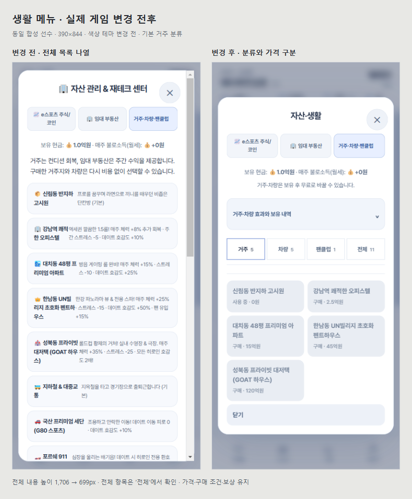
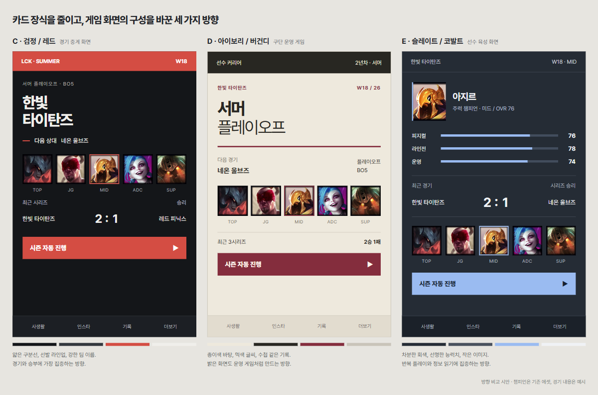

# 베타 준비: 긴 메뉴 보강과 화면 방향 검토

**로컬 v2.9.3/25 · 배포 없음.** 긴 메뉴 보강은 구현·검증했다. 전체 화면 테마는 사용자가 아직 선택하지 않아 적용하지 않았으며, 첫 베타가 완성됐다고 판정하지 않는다. [베타 범위와 남은 기준](../BETA1_SCOPE_AND_PLAN_2026-11-05.md).

## 실제 바뀐 메뉴

- 생활 목록은 거주·차량·팬클럽·전체로, 주식 선택은 매수·매도·전체로 분류한다. 원본 버튼 배열과 선택 인덱스는 그대로다.
- 장비/스킨/생활의 상품명과 비용·보유/사용 상태를 분리해 표시한다. 상세 효과는 펼쳐서 읽으며 전체 상품도 계속 볼 수 있다.
- 거래 후 상단 지갑을 즉시 갱신한다. X·배경 클릭·탭 이동·선택 완료 때 분류 도구와 목록 스타일을 정리한다.
- 분류 기억은 현재 선수 객체를 키로 하는 메모리 WeakMap이다. 저장키·선수 필드·가격·수량·성장·경제·인연·연령 조건 변경은 없다.

| 화면 | 변경 전 전체 내용 높이 | 변경 후 기본 거주 분류 | 가로 넘침 |
|---|---:|---:|---|
| 390×844 | 1,706px | 699px | 없음 |
| 320×568 | 2,025px | 758px | 없음 |
| 844×390 | 1,438px | 651px | 없음 |

같은 합성 선수·자산, 접힌 상세와 기본 거주 분류의 비교다. 모든 내용을 제거한 것이 아니라 분류/펼침으로 옮겼다. 세 크기 각각에서 실제 분류 전환·전체 목록 스크롤·X 닫기·선수 상태 불변을 검사했다. 차량/주식/장비 거래·HUD·저장 복원은390px에서 검사했다. 합성 선수의 현금보다 비싼 주택은 의도대로 비활성이다.

## 검증 결과

| 검사 | 직접 확인한 결과 |
|---|---|
| 필수 파이프라인 | `[SUCCESS: ALL TESTS PASSED]` |
| 전체 단위 회귀 | 245개 중241PASS·실패0·기존 선택4SKIP |
| 독립 구문·버전 | `SYNTAX_OK`, index/sw/양쪽version 2.9.3/25동기화 |
| 구세이브 | 기존5저장키·부분 손상 상태 단위 회귀 통과, 거래 후 브라우저 재로드 복원 |
| 수정 전후 브라우저26주 | 공식23경기·12승11패·확인/선택20회·결산1·2년차1주, 전체P와 다음난수 일치 |
| 다포지션 비교 | 아마/프로×5역할,260주 쌍(총520실행주), 게임상태·저장게임상태·다음난수 일치 |
| 완전자동26주 | 프로23경기·결산1·다음시즌, 입력대기0 |
| 실제 선수 생성26주 | 브리핑26·결산1·다음시즌, 아마 유지·공식프로경기0·입력대기0 |
| 화면 회귀 | 320/390/1100 및844×390 등43조건, 가로넘침0·JS오류0 |
| 사진·저장 | 23인 초상화·이미지 실패3후보 제한·150%확대·장소/표정·재로드·캐시 준비 후 오프라인 통과 |
| 기존 Android 파일 | APK/AAB/ZIP SHA256 동일, 재빌드/배포 없음 |

수정 전 기준은 이번 작업 직전2.9.2의 동결 HTML이며 SHA256은 `5664dbe1fe2042731dac3ef235f795e7db0bdaf3426e34e9e9aac672e67aae31`이다. VM 다포지션 비교는 기존 표시 metadata `weeklyBriefingHistory[].notices`만 제외한다. 브라우저26주 비교는 이 필드도 포함한 전체P가 일치했다. 확인20회는 전체 클릭수가 아니며 일정 진행26회·검증 재열람은 제외한다. 단위 검사4SKIP는 옛 선택적 장기 비교이고, 이번 수정 전후260주 비교는 별도 실행했다.

독립 리뷰에서 배경 종료의 분류 도구 잔류를 지적했다. 실제 브라우저에서 실패를 확인한 뒤 X와 같은 정리를 적용하고 배경 클릭·도구/클래스 제거 조건까지 통과했다. 단위 하니스에는 실제 DOM의 remove/toggle 스텁을 보충했다. 테스트를 위해 제품의 거래/경기/정산 함수를 대체한 브라우저 검증은 아니다. VM 비교에서는 기존 하니스의 대화/렌더 스텁을 사용한다.

증거: [메뉴](beta1/menu-browser.json), [26주 비교](beta1/season-summary.json), [다포지션](beta1/preservation.json), [자동](beta1/auto.json), [신인](beta1/create.json), [43화면](beta1/ui.json).

실제 Android/iOS·OS 가상키보드·설치PWA·모든 이용자 세이브·사람의 재미를 전수 확인한 결과는 아니다. 43화면은 Chromium 뷰포트 검사다. 기존 모바일 키보드 단위 검사는 visualViewport 모의 수치를 사용한다. 표준 파이프라인의 패키지 PASS도 기존2.7.1파일의 존재/무결성 검사이며 새 앱 빌드가 아니다.

## 시안과 다음 방향

위는 StageShow 원칙을 참고한 별도 구성 비교 목업이다. 챔피언은 기존 에셋이고 경기 내용/라인업은 예시다. 실제 플레이 캡처나 이미 적용한 테마로 보고하지 않는다. C는 검정/레드 중계, D는 아이보리/버건디 구단 운영, E는 슬레이트/코발트 선수 육성이다. A/B는 사용자가 거절했고 C/D/E도 미확정이다.

사용자는 모바일 앱·야간 사용까지 감안한 의견을 요청했다. 추천은 **중성 차콜의 기본 화면, 한 단계 밝은 메뉴 표면, 부드러운 흰 글씨, 실제 사진/챔피언이 주는 색감**이다. 팀 색상은 작은 구분선/현재 선택에 제한하고 빨강·초록은 패배/승리 등 의미를 구분한다. 라운드 카드·보라 그라데이션·네온·장식용 숫자 대신 팀/다음 경기/스코어와 선수 능력치의 위계를 먼저 바꾼다. 홈→경기→결산의 실제 화면 한 세트를 기준으로 판단하며 색상 후보를 계속 늘리지 않는다.

이는 프로젝트에 대한 디자인 제안이다. Apple의[다크 모드 지침](https://developer.apple.com/design/human-interface-guidelines/dark-mode)은 저조도 환경·시스템 외관 선호와 명도 차이로 표면을 구분하는 원칙을 설명한다. [색상 지침](https://developer.apple.com/design/human-interface-guidelines/color)은 어두운 환경에서 지나치게 밝은 물체·깜빡임을 주의하도록 한다. 다크라는 이유만으로 가독성을 보장하지 않으므로 실제 글·사진·상태의 대비를 검사한다.

남은 베타 작업: 이 방향에 대한 의견을 반영한 실제 홈/경기/결산 구성 → 인연/SNS/상점의 같은 규칙 적용 → 짧은 화면/키보드/터치 대상 최종 점검 → 같은 시즌 회귀 및 실제 기기/사람 플레이의 미확인 범위 보고. 새 경영/FA/히로인 가지는 늘리지 않는다. 배포·push·Android 재빌드는 하지 않는다.
