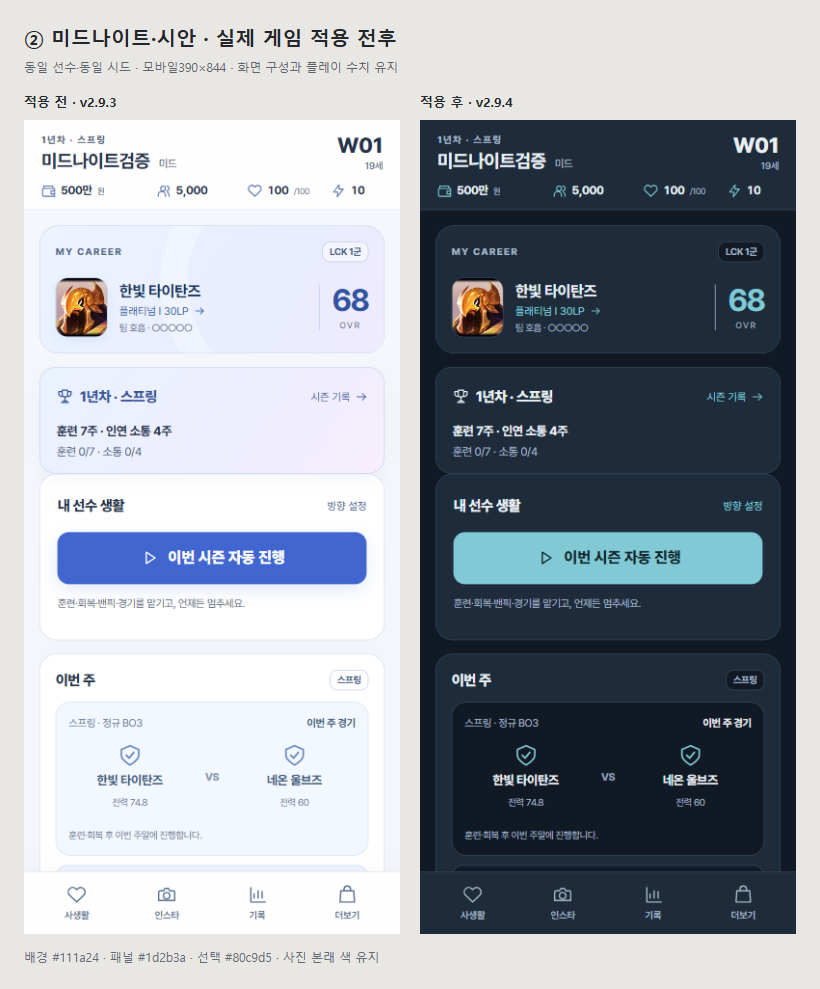

# ② 미드나이트·시안 적용 결과

**로컬 v2.9.4/26에 적용 완료. 배포하지 않았다.** 사용자가 선택한② 색상으로 홈·경기 전후·결산·인연·인스타·상점·기록을 맞췄다. 화면 배치와 플레이 수치는 유지했다.

## 바뀐 부분

| 용도 | 색상 |
|---|---|
| 바탕 | `#111a24` |
| 패널 | `#1d2b3a` |
| 경계 | `#354b60` |
| 본문 / 보조글 | `#e9f0f4` / `#a4b6c6` |
| 주요 선택 / 버튼 글자 | `#80c9d5` / `#12262c` |

- 주요 진행·선택을 시안색으로 통일했다. 승리/증가·패배/감소·보상은 각각의 문구와 의미 색을 유지한다.
- 밝은 모달·랭킹 헤더·보라 그라데이션 장식과 어두운 표면에서 읽히지 않던 옛 글자색을 정리했다. 사진 자체 색·에셋·확대 기능은 유지한다.
- PWA 상단 메타색과 manifest 바탕색도 맞췄다. 모바일 너비·닫기·키보드 높이 대응 등 기존 구조는 유지한다.

[대화 전후](midnight/comparison-dialogue.png) · [시즌 여정 전후](midnight/comparison-season.png) · [실제26주 결산](midnight/season-review.png) · [게시물 시각](midnight/sns-post-time.png) · [DM](midnight/sns-dm.png)

전후 홈/대화/시즌 캡처는 같은 시드·합성 선수로 직접 실행했고 전체P와 사진 파일이 일치한다. 목업이 아니라 로컬 실제 게임 캡처다. 사용자의 실제 저장소는 건드리지 않았다.

## 검증

| 항목 | 직접 확인한 결과 |
|---|---|
| 필수 파이프라인 | **`[SUCCESS: ALL TESTS PASSED]`** |
| 전체 단위 회귀 | **245개 중241PASS / 실패0 / 기존 선택4SKIP** |
| 구문·버전 | `SYNTAX_OK`, index/sw/양쪽version **2.9.4/26** 동기화 |
| 색상 검사 | 생성·펼친 능력치·홈·모달·내용 있는 게시물/DM 등 **43조건**, 검사 대상 대비 부족0·가로 넘침0·JS오류0 |
| 기존 화면 회귀 | 별도 **43조건**(색상 검사와 중복 포함),320/390/1100·844×390, 23인 사진·150% 확대·긴 이름·오프라인 PASS |
| 수정 전후26주 | 양쪽 모두 **공식23경기·12승11패·결산1·2년차1주**. 전체P·다음난수·확인/선택20회 일치 |
| 다포지션 | 아마/프로×5역할, **260주 쌍(총520실행주)** 전체상태·다음난수·저장바이트 일치. 제외필드0 |
| 자동 시즌 | 프로26주23경기·결산1·입력대기0. 실제 생성 신인도26주·브리핑26·결산1·다음시즌, 기존대로 아마/공식프로0 |
| 거래·구세이브 | 차량 구매·주식10주 매수/전량매도·장비·실제비용·분류/취소·HUD·재로드 PASS. 기존5저장키 단위 회귀 PASS |
| 코드·패키지 | 게임 JavaScript는 버전 상수2곳 외 직전2.9.3과 동일. APK/AAB/ZIP SHA256 동일, 재빌드 없음 |

필수 파이프라인은 터미널에서 직접 실행했다. 단위 검사4SKIP는 옛 선택 장기 비교이며 이번260주 쌍 비교는 별도 실행했다. 브라우저의 확인20회는 전체 클릭수가 아니며 일정 진행26회·검증 재열람을 제외한다. VM 시뮬레이션은 기존 하니스의 대화/렌더 스텁을 사용하고, 실제 브라우저26주에서는 경기/정산 함수를 대체하지 않았다.

## 발견하고 고친 대비 문제

독립 리뷰와 실제 화면 검사를 통해 **펼친 능력치 라벨(2.73:1)**, **실제 게시물/DM 시각(3.7:1)**을 확인했다. 두 상태를 회귀에 추가해 실패를 재현한 뒤 공통 보조글 색으로 수정했고,43조건 통과와 재리뷰를 확인했다. 랭킹 소속명·인스타 스토리 이름·인증 표시도 실제 검사에서 보강했다.

자동 대비 검사는 화면에 보이는 일반 글4.5:1·큰 글3:1을 기준으로 한다. 비활성/잠긴 항목·사진/그라데이션 위 글은 자동 계산에서 제외하며 대표 대화/사진 태그는 직접 확인했다. 가능한 모든 이야기 상태와 실제 휴대폰의 표시 품질을 전수 검증했다는 뜻은 아니다.

## 범위와 다음 작업

현재 상태는 **선택한 색상 적용 완료**다. 첫 웹 베타 전체 완료는 별도로 판단한다. 다음은 이 색상 기준을 고정한 채 첫 실행→일정→경기→인연→결산 순서에서 정보 위계·반복 문구·작은 터치 대상을 종합 점검하는 것이다. 신규 경영/FA/히로인 가지는 늘리지 않는다.

실제 Android/iOS·OS 가상키보드·설치PWA·사람의 첫 플레이는 이번 Chromium 뷰포트 검사와 구분한다. 기존 키보드 단위 회귀는 visualViewport 모의 수치다. 배포·push·커밋·APK/AAB 재빌드·Riot 문의 재발송은 하지 않았다. 파이프라인의 패키지 PASS도 기존2.7.1파일 무결성이며 이번 웹 버전 앱 빌드를 뜻하지 않는다.

증거: [테마43](midnight/theme-browser.json), [기존UI43](midnight/ui.json), [26주](midnight/season-summary.json), [다포지션 전체 비교](midnight/preservation.json), [프로 자동](midnight/auto.json), [신인 생성](midnight/create.json), [거래](midnight/menu.json), [계획](../MIDNIGHT_THEME_PLAN_2026-11-05.md).
