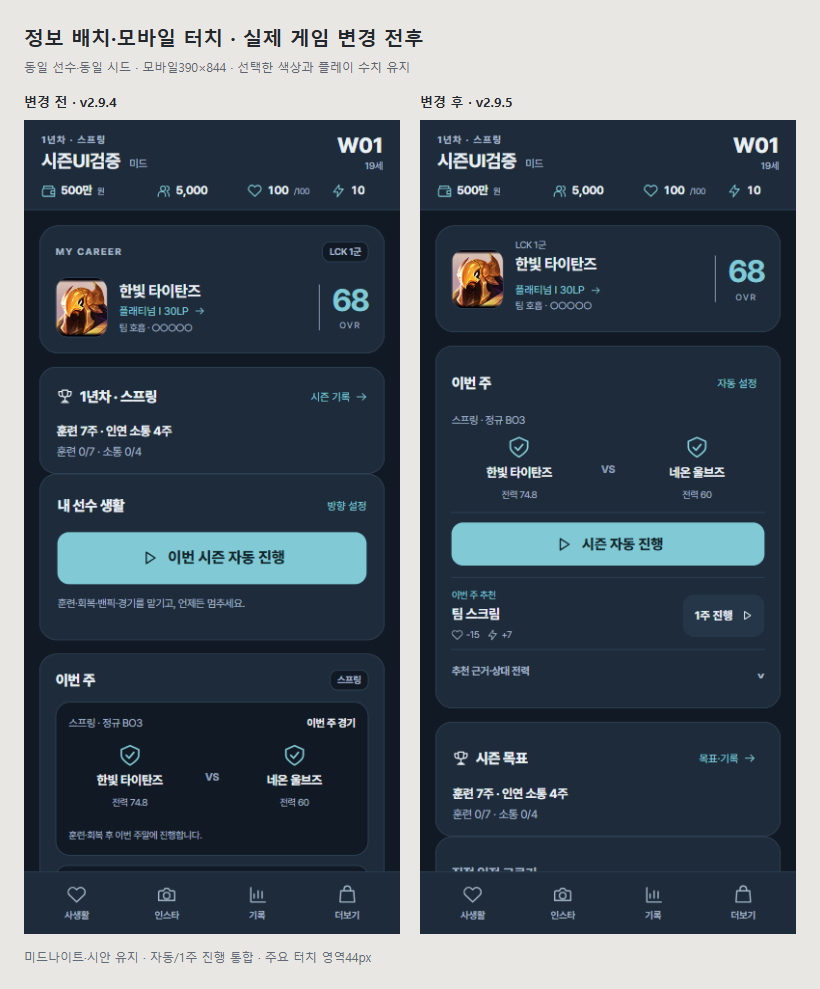

# 한 시즌 UI 흐름 보강 결과

**미드나이트·시안을 유지한 로컬 v2.9.5/27. 배포하지 않았다.** 정보 배치·반복 문구·모바일 터치 영역을 함께 보강하고, 정의한 로컬 검증 기준을 충족한 **웹 베타1 검토 후보**로 정리했다. 실제 기기/사람의 플레이·공개 배포 승인은 별도다.

## 실제 바뀐 경험

| 변경 전 | 변경 후 |
|---|---|
| 시즌 목표·자동 안내·이번 주 경기가 여러 카드로 이어짐 | 이번 주 경기·자동 설정·시즌 자동·1주 진행을 한 영역에 배치 |
| 390×844에서1주 진행 버튼이 화면 아래에 있음 | 자동과1주 진행을 모두 첫 화면에서 선택 가능 |
| 주차/시즌·자동 설명·경기 사건이 반복됨 | 시즌 제목은‘시즌 목표’, 추천 근거/상대 분석/자동 안내는 펼침, 전체 사건은 주간 상세에 보존 |
| 랭킹·설정·탭·프로필/사진 등의 일부 터치 영역이 작음 | 주요 버튼/summary/폼/사진 확대44px, 입력 글자16px |
| 인스타 제목에 브랜드명이 다시 반복됨 | 제목은‘인스타그램’, 본문 브랜드는 유지. 헤더/액션 버튼 간격과 크기 조정 |

체력·스트레스·돈의 비용과 효과는 이번 주 추천 옆에 계속 보인다. 자동/1주/설정/랭킹/브리핑은 기존 처리 함수로 연결한다. 전체 사건·선택지·계약/관계 정보·지난 기록을 삭제하지 않았다. 게임 로직/새 상태 필드/저장키·팔레트·사진 에셋을 바꾸지 않았다.

[인스타 전후](ux-polish/comparison-sns.png) · [직접 일정 전후](ux-polish/comparison-actions.png) · [모의 키보드 입력](ux-polish/keyboard.png) · [실제5세트 사진 버튼](ux-polish/five-sets.png)

## 전후 수치

| 측정 | 변경 전 | 변경 후 |
|---|---:|---:|
| 390px 홈의1주 진행 버튼 아래쪽 위치 | 905px | 536px |
| 같은 화면의 하단 메뉴 시작 | 779px | 779px |
| 안정 프레임44px미만 활성 터치 대상 관측 | 133 | 0 |

같은 합성 선수·시드·390×844 실제 화면이다. 터치 관측은23개 화면/크기 조건에서 같은 버튼을 여러 번 포함하며, 변경 후303개 대상 관측을 확인했다. 133개가 서로 다른 고유 버튼이라는 뜻은 아니다. 모달 등장 애니메이션이 끝난 안정 프레임에서 측정했다. 키보드 이미지는 실제 OS 키보드 사진이 아니라 가시 영역360px/상단12px을 주입한 Chromium 검사다.

## 26주와 세이브·밸런스

| 검사 | 확인한 결과 |
|---|---|
| 실제 브라우저 전후26주 | 양쪽 **공식23경기·12승11패·결산1·2년차1주** |
| 전체 선수 상태·다음난수 | 전후 동일. 확인/선택20회도 동일 |
| 아마/프로×5역할 | **260주쌍(총520실행주)** 전체상태·난수·저장바이트 동일. 제외필드0 |
| 실제 생성 신인 | 26주·브리핑26·결산1·다음시즌. 기존대로 아마/공식프로경기0 |
| 별도 프로 완전자동 | 26주23경기·결산1·다음시즌, 입력대기0 |
| 구세이브·거래 | 기존5저장키 단위 회귀, 차량/장비 구매·주식10주 매수/전량매도·원래비용·분류/취소·HUD·재로드 PASS |
| 표시 재열람 | 반복 렌더·시즌/주간 상세로 P·저장·난수 불변. 생략한 경기 주 사건도 상세에서 확인 |

기준은 이번 작업 직전2.9.4 동결 HTML이며 SHA256은 `9399aee3e77341473c7b78e66bafee3842b7d4a10c6122ee257819a2ca4eed75`다. VM 비교는 기존 대화/렌더 스텁을 사용하고, 실제 브라우저26주는 경기·정산 함수를 대체하지 않았다. 확인20회는 전체 클릭수가 아니며 일정 진행26회·검증 재열람은 제외한다.

## 검증 결과

| 검사 | 결과 |
|---|---|
| 필수 `node verify_pipeline.js` | **`[SUCCESS: ALL TESTS PASSED]`** |
| 전체 단위 회귀 | **247개 중243PASS·실패0·기존 선택4SKIP** |
| 독립 구문·버전 | `SYNTAX_OK`, index/sw/양쪽version **2.9.5/27** 동기화 |
| 새 UI 검사 | 23조건·터치303관측,44px미만0·넘침0·JS오류0 |
| 화면·색상 회귀 | 기존 화면43조건 + 테마43조건(중복 포함),23인 사진·긴 이름·빈 기록·150% 확대·오프라인 PASS |
| 모바일 실제 조작 | touch/mobile컨텍스트320×568/390×844/844×390 설정·취소·랭킹포커스·추천 근거 펼침 PASS |
| 내용 있는 SNS·모의 키보드 | 입력44px·글자16px·가시영역 침범0·입력 초안 보존·메뉴 숨김/복원·DM 전환 PASS |
| 실제 BO5 사진 | 실제2:3/5세트,320px에서44px사진5개·겹침/넘침0·150%확대 PASS |
| 관계/커리어 회귀 | 연인1+썸2·주간데이트·실제 커플 사진/문구·발각/신뢰·자동중지/재개·챔피언45·저장/오프라인 PASS |
| 시리즈/계약 회귀 | 실제BO5 정산1회·숙련100/체력8,26주평가·계약/결산·중간세트리로드·수동→자동 PASS |
| 기존 Android 파일 | APK/AAB/ZIP SHA256 동일, 재빌드 없음 |

신규2개 단위검사는 현재2PASS, 동결 이전 버전에서는 중복 문구 조건1FAIL을 확인했다. UI 브라우저도 변경 전‘자동과1주 진행 분리’로 실패하고 변경 후 통과했다. 독립 리뷰는 처리 함수/비용/정보 보존과 실제7캡처를 확인했고 수정 필요 결함을 보고하지 않았다. 리뷰의 좁은 홈·채운 피드·키보드 검사 범위 지적은 별도의 모바일 상호작용 검사로 보강했다.

랭킹은 기존 `updateKrRank()` 정규화를 마친 합성 데이터에서 재열람 상태 불변을 검사했다. 최초 랭킹 캐시 생성 규칙을 제품에서 바꾼 것이 아니다. 키보드 검사는 터치/coarse 입력 컨텍스트에서 visualViewport를 주입한다. 실제 Android/iOS·OS 키보드·설치PWA·모든 이용자 세이브·사람의 재미를 전수검증했다는 뜻은 아니다. 단위4SKIP는 옛 선택 장기비교이며 이번260주쌍은 별도 실행했다.

## 다음 확인

이번까지의 범위는 [베타 계획](../BETA1_SCOPE_AND_PLAN_2026-11-05.md)의 로컬 자동검증 게이트를 충족한다. 다음은 새 가지를 늘리지 않고 실제 휴대폰과 사람의 첫 시즌 플레이에서 이해·조작 피로·사진 감상·재미를 확인하는 단계다. 공개 배포나 앱 패키지 제작은 새 승인 범위다. 이번에는 배포/push/커밋/APK·AAB 재빌드를 하지 않았다.

증거: [전후 지표](ux-polish/before-after-metrics.json), [UI 터치](ux-polish/browser.json), [모바일 조작/키보드/5세트](ux-polish/interaction.json), [26주 비교](ux-polish/season-summary.json), [전체상태·저장바이트](ux-polish/preservation.json), [화면43](ux-polish/ui.json), [테마43](ux-polish/theme.json), [거래](ux-polish/menu.json), [자동](ux-polish/auto.json), [신인](ux-polish/create.json), [관계](ux-polish/core.json), [시리즈/계약](ux-polish/series.json).
